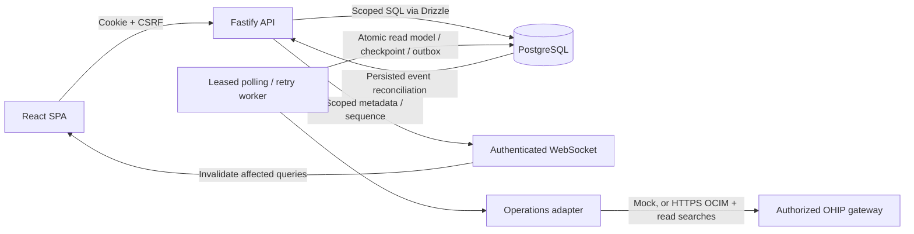

# Architecture and deployment considerations

## Components

`apps/api` contains Fastify HTTP/WebSocket transport, cookie sessions/authorization, operational services, Drizzle queries, the polling worker, and separate mock/real adapters. `apps/web` contains the React Router SPA and TanStack Query cache. `packages/contracts` contains shared DTOs and role policies. `db/migrations` is the authoritative PostgreSQL schema. Server deployments use node-postgres; native local demo startup defaults to persistent PGlite. Both deployments run compiled JavaScript and serve built React assets through the same Fastify port; see [deployment boundaries](DEPLOYMENT.md).

The runtime worker is colocated with the API in this V1. `SKIP LOCKED` and leases prevent concurrent ownership of queued jobs; stale leases return to the queue. Every retry operation is an allowlisted reservation read. An active-job unique index prevents duplicate pending polls for a property. Stored fingerprints deduplicate integration observations; SQL `IS DISTINCT FROM` keeps snapshot writes idempotent while allowing A→B→A changes. No upstream mutation is sent.

Database transactions persist business writes, administrator audit and change events together. WebSocket connections independently read the durable outbox every second, making process restart/reconnection recoverable. More than 100 missed visible events causes full query reconciliation; smaller gaps replay scoped topic markers. Sequence high-water marks only include visible events. No guest names, contact details, credentials or record bodies enter that channel.

## Security boundaries

- Sessions are 256-bit random opaque values; only SHA-256 token hashes are persisted. Eight-hour expiry, HttpOnly/SameSite=Strict cookies, optional Secure enforced in production. Passwords use salted scrypt. No tokens in browser storage.
- Tenant membership is loaded from the session for every request. Properties require explicit grants, including platform administrators. Regional summaries use server-side authorization filters. Composite foreign keys prevent cross-tenant relational references.
- Browser mutations require the session CSRF token and accepted Origin. WebSocket upgrades require cookie authentication, exact configured Origin and CSRF. Session expiry, logout, tenant switching and access editing revoke established sockets on the next reconciliation.
- Role rules are enforced by API handlers as well as navigation. Guest records are restricted from housekeeping and IT. Integration and administrator endpoints have separate checks. Developer metadata additionally requires a non-UI-grantable developer flag.
- OHIP secrets use AES-256-GCM with random nonce/authentication tag. Only whitelisted public connection columns are returned. Logs contain operation/status/latency/classification/request ID, never headers, raw Oracle responses, or guest payloads. Errors returned publicly omit internal SQL/stack traces.
- Rate limiting, Helmet/CSP, request-size limits, Zod/AJV validation, parameterized SQL and exact server-maintained HTTPS gateway allowlisting are enabled. Admin-provided text is rendered as React text; no raw HTML rendering is used.

## Data model

Tenants own organizations, properties, branding and app-instance hostname mappings. Users have tenant memberships with roles, then explicit property grants. Sessions select a single tenant. Connections map a property to an environment, gateway, enterprise/chain/hotel and encrypted credential bundle. Reservation read models and guest flags are separate from local rooms/tasks. Integration logs, observed integration events, job checkpoints/retries, change-event outbox and administrator audits are durable PostgreSQL records.

A platform administrator provisions a new tenant without adopting any other tenant's data. Switching requires an existing membership and rotates CSRF. New properties start with no reservations, rooms or connection; the creating admin receives a grant. New users may validly have no grants. Editing another user's role/grants revokes that user's sessions, unassigns tasks for removed grants and records an audit. Tenant/property deletion and bulk-destructive administrator actions are not exposed.

## Before production

The local Compose configuration is for development. Production deployment has **not** been authorized or performed. Required environment work includes TLS termination and same-origin WebSocket forwarding; a per-instance `APP_ORIGIN`; Secure cookies; encrypted PostgreSQL transport, least-privilege DB roles and backups; external secret/key custody and rotation; change-controlled migrations; email/account recovery/MFA/SSO policy; durable monitoring and tested restore/recovery; data retention and audit access/export policies; dependency/image pinning/scanning; shared rate/quota limits across replicas; and load/reconnect/soak testing.

This V1 uses application authorization and relational constraints, not PostgreSQL row-level security. Review every new route/query under that boundary. Runtime schema migration needs DDL privileges; split migration and application roles during deployment. Outbox, integration events/logs and completed jobs need a defined retention/partition policy before sustained production traffic. In-process token reuse and rate limiting do not coordinate across replicas. The single process worker and one-second event reconciliation should be measured and separated/optimized for larger fleets. No database RLS, HA or horizontal-load claims are made.

Hostname branding resolution chooses an app-instance identity for the public login and the authenticated tenant identity thereafter. Use a deployment per approved origin, or implement an explicit verified multi-origin registry before hosting several unrelated customer origins in one process. Do not accept arbitrary request Origin values as trusted configuration.

OHIP acceptance still requires valid customer credentials, correct OCIM environment mapping, subscribed API permissions, gateway trust, actual pagination/rate entitlement verification and a real property's dataset. No fixture test replaces that acceptance. Business Event/Streaming ingestion remains capability gated and unimplemented until that contract is supplied and enabled; polling is the current supported ingestion path. Notification emails, full CRM/housekeeping integration, financial KPIs and historical snapshots are outside this initial read-only slice.
